# Battlefield 1943 - Xbox 360 Recomp
An unofficial native PC port of the Xbox 360 version of Battlefield 1943, with extended graphics options, keyboard and mouse support, multiplayer with bots, and other enhancements.

This port was created using the [XenonRecomp](https://github.com/hedge-dev/XenonRecomp) tool, with a Vulkan renderer based on [Xenia](https://github.com/xenia-project/xenia)'s GPU backend. Battlefield: Bad Company is in progress with the same tools.

> [!NOTE]
> This project does not include any game assets. You must provide the files from your own legally acquired copy of the game to install or build.

## Installation
The latest version of the launcher can be found in the [Releases](https://github.com/papand7/Battlefield-Recompilation-Project/releases) page.

- Put `BattlefieldLauncher-<version>.exe` in a folder together with your game files: Battlefield 1943 **version 1.06** (the game package, or `default.xex` in an unpacked folder), and/or Battlefield: Bad Company (the **USA disc** `.iso`, or `default.xex` in an unpacked folder).
- Run it, pick a game at the top and press **INSTALL** (or **Choose game files…** first, if your files are somewhere else). It checks your files, installs the free build tools it needs through winget, and compiles the game's code for your PC, which takes about 5 to 60 minutes and only happens once.
- Press **Play**. Settings can be adjusted in the launcher, or in game under **Settings**, opened with <kbd>F10</kbd> at any time.

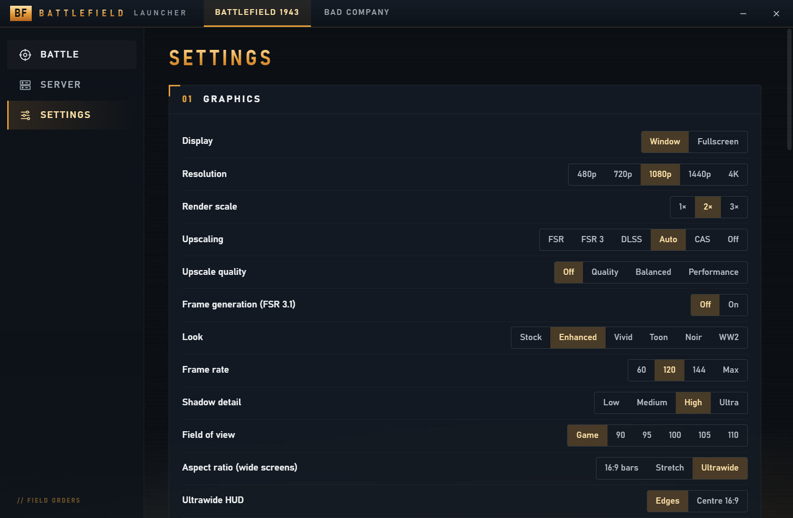

**Linux:** `BattlefieldLauncher-<version>-x86_64.AppImage` works the same way: `chmod +x` it, put it next to your game files and start it. It builds the games with `bf1943-recomp/build_linux.sh` and lists the packages to install if any are missing. **macOS:** experimental and untested, built from source (see [Building](#macos-experimental-untested)).

## Original vs Ultra
Left the original game as it was on the Xbox 360 (`Stock`), right the **Enhanced** look with every effect at its highest setting, ray tracing and the HD texture pack, from the same spawn.

| Original | Ultra |
|---|---|
| 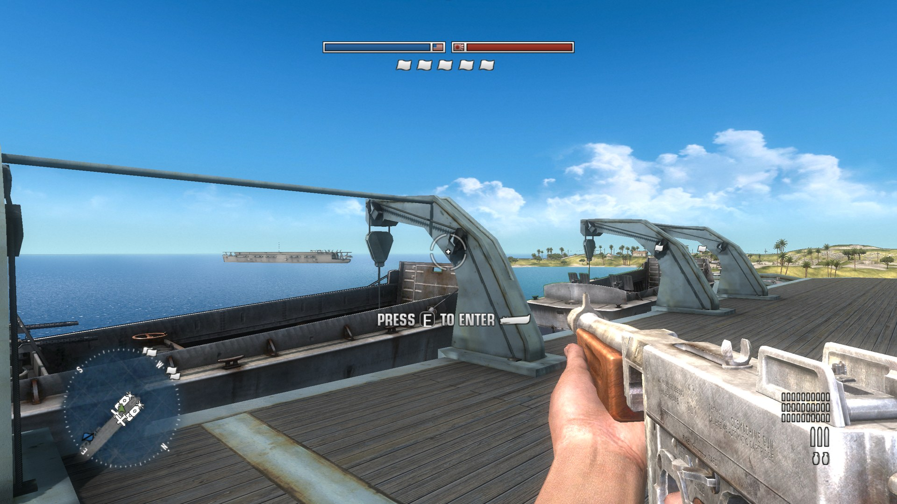 | 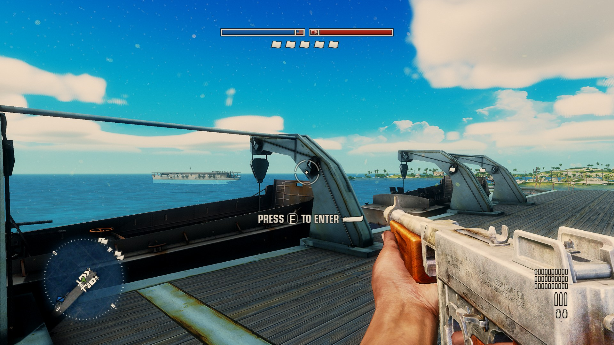 |
| 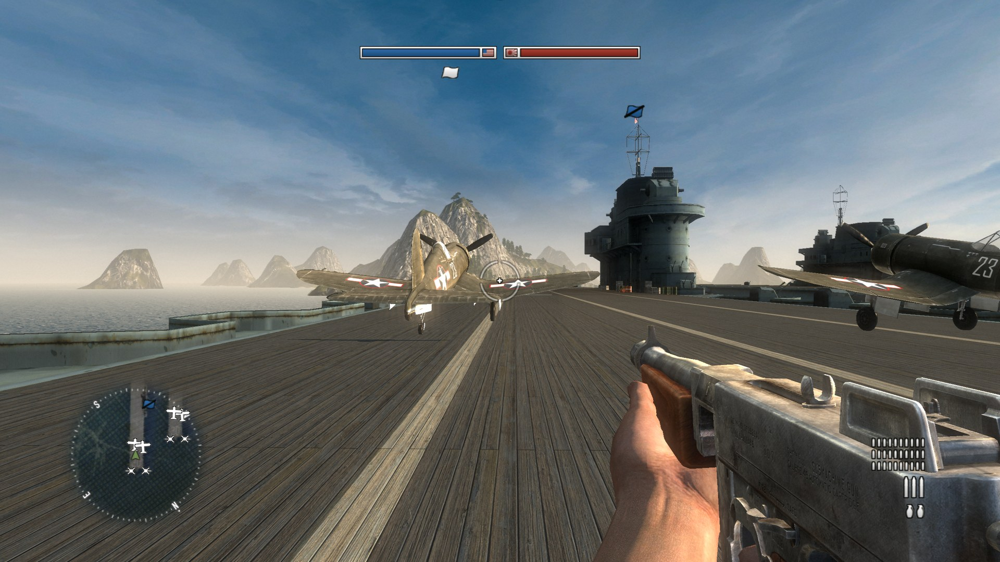 | 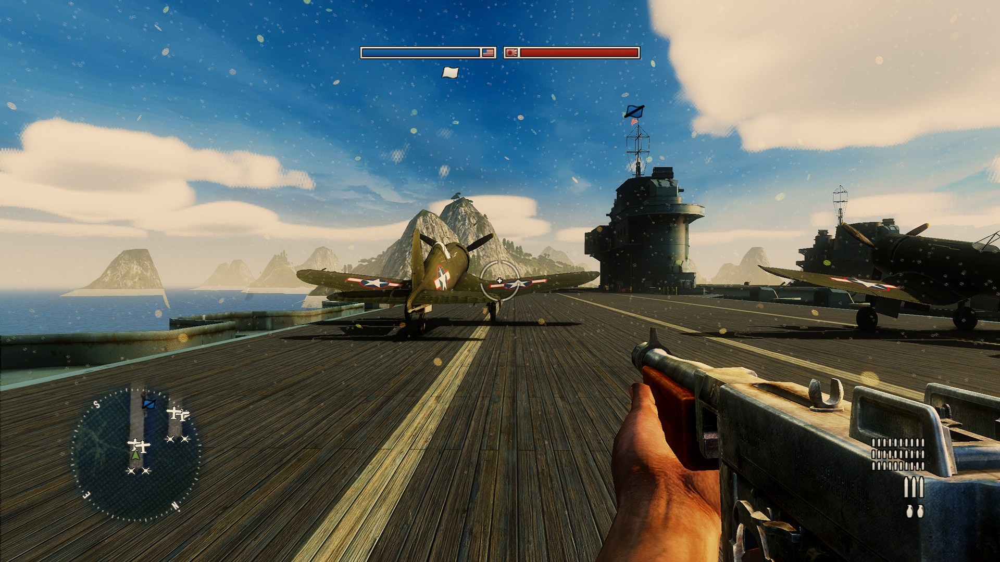 |
| 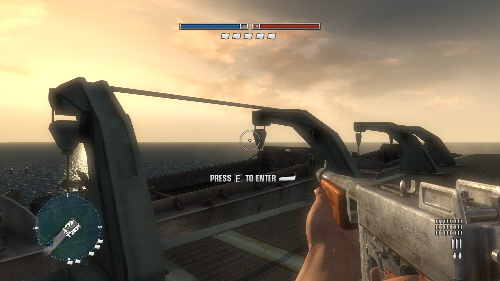 | 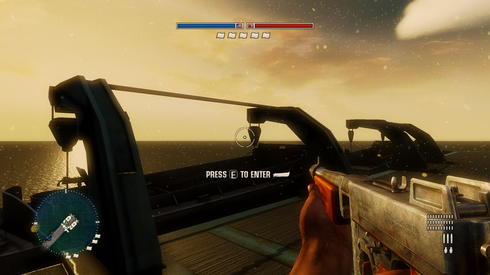 |
| 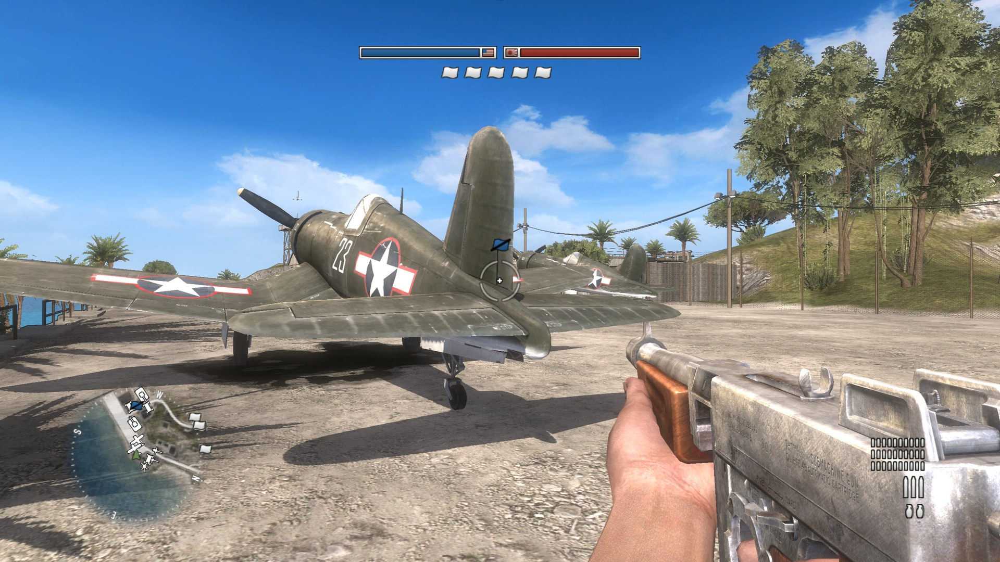 | 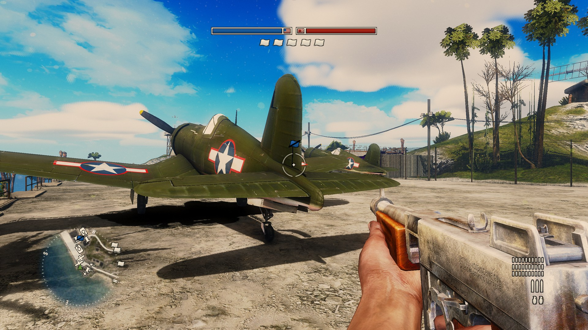 |

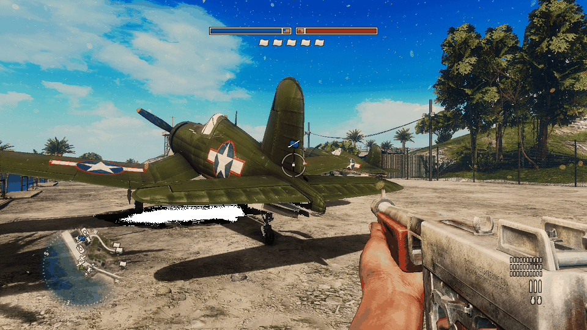

**Rain** (`/weather rain`, or `--weather rain` on a server): falling rain, drops on the lens, an overcast sky, and puddles on flat ground that mirror what stands over them.

| Guadalcanal | Wake Island |
|---|---|
| 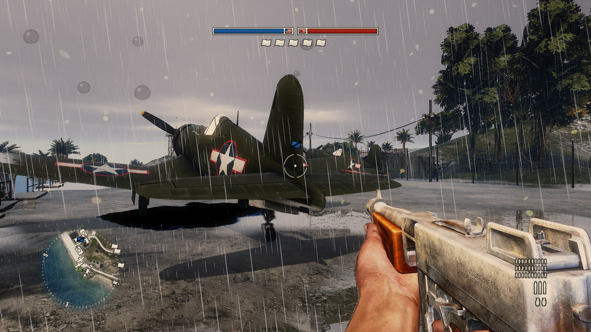 | 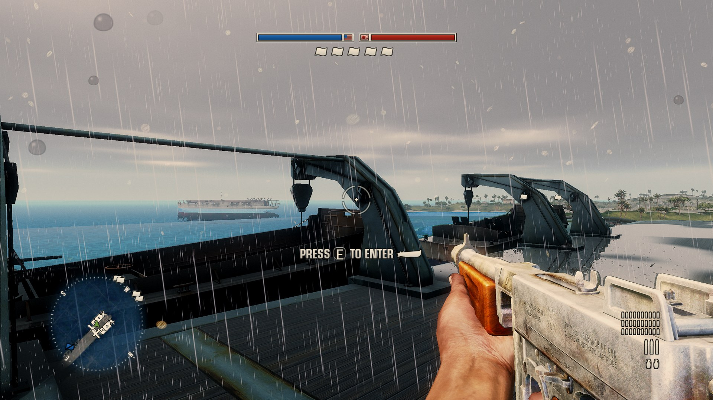 |

**Looks**: the same view in each of the looks (**Settings → Graphics → Look**).

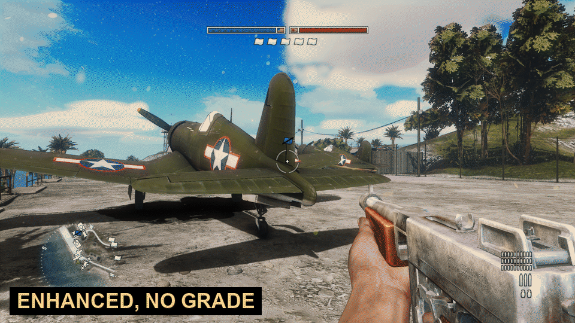

## Features
### Display
- **Resolution** - Up to 4K, with a resolution scale of 1x, 2x or 3x.
- **Upscaling** - AMD FSR, FSR 3 and NVIDIA DLSS (on RTX cards), or **Auto** to pick the best your GPU has, with a **Sharpness** setting.
- **Frame Generation** - AMD FSR 3.1 frame generation, roughly doubling the frames shown on any Vulkan GPU (needs the scene effects on).
- **Max Frame Rate** - 60, 120, 144, 165, 240 or unlimited, with the game running smoothly at them.
- **Adaptive Quality** - Optional: keeps 60 (or 30) fps by easing the heaviest effects when a scene gets busy, and bringing them back when it calms down.
- **Ultrawide** - 21:9 and wider without bars, with the HUD moved out to the screen's edges (or kept in the middle), or stretched, or the original 16:9 with bars.
- **Motion Blur** - The game's own (explosions, low health), or a low or high camera blur as you turn and move.
- **HDR Output** - On HDR monitors.

### Graphics
- **Ray-traced Shadows** - On GPUs with ray tracing, every object, tree and hill casts a proper shadow, even from off screen. Without it, screen-space shadows are used instead.
- **Ray-traced Lighting** - Bounce light and ambient occlusion.
- **Atmosphere** - Light shafts and haze, volumetric clouds and their shadows.
- **Water** - Foam along ships and beaches, clear turquoise shallows, and waves that bend what's below.
- **Surface Depth** - Parallax, and small details like pebbles and cracks on bare ground.
- **Muzzle Flash** - A realistic flash that lights only what's near your gun.
- **Living Plants** - Palms, grass and bushes sway in gusts of wind, and their ray-traced shadows sway with them.
- **Air** - Optional drifting leaves and dust motes in the sunlight.
- **Looks** - Enhanced, Toon, Noir and WW2 newsreel film, or Stock for the original.
- **Blood and Gore** - Optional.

### Textures
- **HD Texture Pack** - Realistic materials: metal shines, wood and rust look rough.

### Input
- **Mouse and Keyboard** - Full keyboard and mouse support, with every key rebindable under **Settings → Keys**. The mouse turns the view directly (raw input, not an emulated stick), and also works over Remote Desktop.
- **Vehicles on the Keyboard** - W and S for throttle and brake, A and D to steer, the arrow keys to fly planes, Space to fire and C to change the camera view, with a separate plane mouse sensitivity.
- **Controllers** - Xbox pads through XInput, and PlayStation (DualShock 3/4, DualSense), Nintendo Switch Pro, Steam Deck and other generic pads through SDL3's gamepad support, on Windows, Linux and macOS, with hot-plug and rumble. **Button Prompts: Auto** shows the buttons of the pad you plug in (Xbox, PlayStation, Steam Deck). Every new menu (Host Game, Join Game, Settings, the pause menu) works with a pad alone, typing included: [docs/CONTROLLERS.md](docs/CONTROLLERS.md).

### Menus
- **New Menus** - A WW2 field-orders look, animated, and made for mouse, keyboard and controller alike. The original intro and title screen are kept.


### Multiplayer
- **LAN Multiplayer** - Host and join on your network: **Host Game** (map, bots, START SERVER) and **Join Game** (the games found on your network and the internet, or an address), or a dedicated server.
- **Join by Address** - **Join Game → Address** (add `:port` if it isn't the usual 1003), or start the game with `--join <address> --host-map <its map>`.
- **Dedicated Server** - Runs with no graphics, from the launcher's **SERVER** page or a console window, on Windows (`start_server.bat`) or Linux (`start_server.sh`).
- **List on the Internet** - Shows a server in everyone's **Join Game** list through the master server: `PUBLISH=1` in the start script, `--publish`, or **List on the internet** when hosting from the game. The router must pass UDP ports 1003 and 19430 to the server.
- **Bots** - Computer players on your server (`--bots N`), half on each team: they capture flags, fight, sprint, drive landing craft, jeeps and tanks, and fly planes. They go in squads of four to the same flag, the first leading and the others staying with it. They play inside the server itself, with no extra copies of the game running. Their navigation meshes are made on your PC from your game files the first time a map needs one.
- **Hardcore** - A server setting (**HOST GAME**, the launcher's **SERVER** page, or `--hardcore`): no HUD or crosshair for anyone, and fewer hits to kill. Hardcore servers are marked in **JOIN GAME**.
- **Chat and Admin Commands** - <kbd>T</kbd> opens a chat line. The host (or a dedicated server's console) can type `/players`, `/kick`, `/ban`, `/unban`, `/map`, `/bots`, `/weather clear|rain` and `/time dawn|day|sunset|night|<hours>` (everyone in the match sees the change); joiners can use them after `/login <admin password>` (`--admin-password`). `/help` lists them all.
- **Spectate** - <kbd>F4</kbd> (or `--spectate`) watches the match on the host's PC: <kbd>N</kbd> / <kbd>B</kbd> to follow the next or previous player, <kbd>Space</kbd> for a free camera, the wheel to zoom.
- **Match Replays** - A host records every match to `replays/`. Play one back with `--replay <file>`, and fly around it with a free camera or follow a player, paused, rewound or up to 16x faster.
- **Learning Bots** - Every server learns from its matches where players go, where they die and where they win fights, per map. Bots use it to hold good spots at a flag and to watch where enemies usually come from, and what servers learned can be merged into the next version (`tools/bot_knowledge.py`).

### Dedicated Server
The launcher's **SERVER** page runs one for the game chosen at the top: its name, the maps it rotates through, bots, listing on the internet, the bot advisor and training runs, with START / STOP, the server's log and the newest training replay (`server_gui.bat` / `server_gui.sh` open the launcher on that page). Without a window, edit and run `start_server.bat` (name, the name browsers show, password, tick rate, maps to rotate through, bots and `PUBLISH`), or:
```
bf1943.exe --game <your game files> --dedicated --name "Player" --servername "My Server" --password secret --tickrate 75 --maps Wake_island_s,Iwo_Jima_s --bots 4 --publish
```
A server with a password shows a padlock in **JOIN GAME** and only lets in players who type it (UDP 19430 must reach the host for that check). Matches run at 75 ticks a second unless `--tickrate 30` (the original game's rate). In game, **HOST GAME** has the same **SERVER NAME** and **PASSWORD** rows.
The host's firewall needs to let the game through: UDP ports 1003 and 19430. For the Linux server, see [the developer guide](docs/DEVELOPERS.md).

**Bot advisor (optional)** - `BOT_LLM=1` in the start script: when a bot keeps getting stuck or is losing a fight, a small vision model (Qwen3.5 4B through llama.cpp, on the server's own PC) is shown a map of its surroundings and picks where it should go. The first start installs it into `llm/` (about 3.5 GB, needs Python; `tools/setup_bot_llm.py`), then the server runs with `--bot-llm llm`. It is faster with a graphics card; on a CPU an answer takes several seconds, and the bots carry on as usual meanwhile. Works for both games' servers (`--bot-llm` on Bad Company's too).

## Battlefield: Bad Company
The same recompiler is being used for Battlefield: Bad Company (Xbox 360). Installed from the same launcher, on Windows and Linux.

- **Campaign** - Plays at about 100 fps at 1x render scale, with keyboard, mouse and the HUD working.
- **HD Texture Pack** - Made by the launcher from your game files, as for Battlefield 1943.
- **LAN Multiplayer** - **MULTIPLAYER** on the main menu opens a new menu: **Host Game** (Gold Rush on one of the 8 maps: Valley Run, Deconstruction, Oasis, Final Ignition, End of the Line, Ascension, Harvest Day, Over and Out), **Server Browser** (the games on your network, with map and ping) and **Join by Address** (add `:port` if it isn't the usual 1503). Two copies on one PC can play together; across two PCs it hasn't been tested yet.
- **Ports** - UDP 1500-1503 and 19431, so it can host on the same PC as Battlefield 1943.
- **Bots** - On a Bad Company server (the launcher's **SERVER** page, or `--bots N`): mixed kits, sprinting, crouching, grenades and vehicles, in squads of four to the same crate, the first leading. Like 1943's bots, they learn from their matches where to hold a crate and where enemies come from.
- **Dedicated Server** - From the launcher's **SERVER** page or `server_gui.bat` / `server_gui.sh`, on Windows and Linux.
- **Shared With 1943** - The scene effects, PBR materials, upscalers (FSR, FSR 3, DLSS), FSR 3.1 frame generation, motion blur, adaptive quality, raw mouse aim, chat and admin commands (`/players`, `/kick`, `/ban`, `/map`, `/bots` ...), and the server's **Hardcore** setting (no HUD or crosshair, fewer hits to kill).
- **Only Gold Rush** - The disc has no Conquest; that came later in an update.
- **Idle Players** - A player who stays on the spawn screen for about two minutes without deploying is sent back to the menu (the game's own rule).
- **Not Done Yet** - Playing online and ray-traced shadows (they stall the opening cutscene). Bots still get stuck in some places. Saving the campaign hasn't been checked yet.

| Original | Ultra |
|---|---|
| 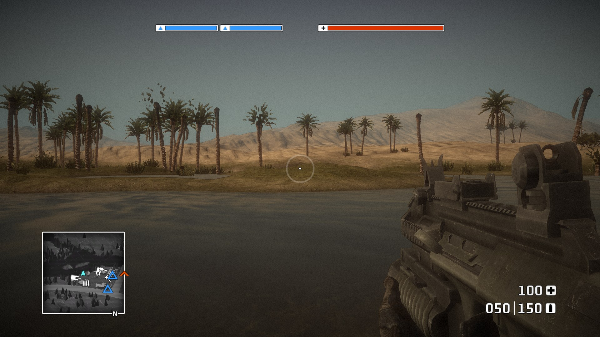 | 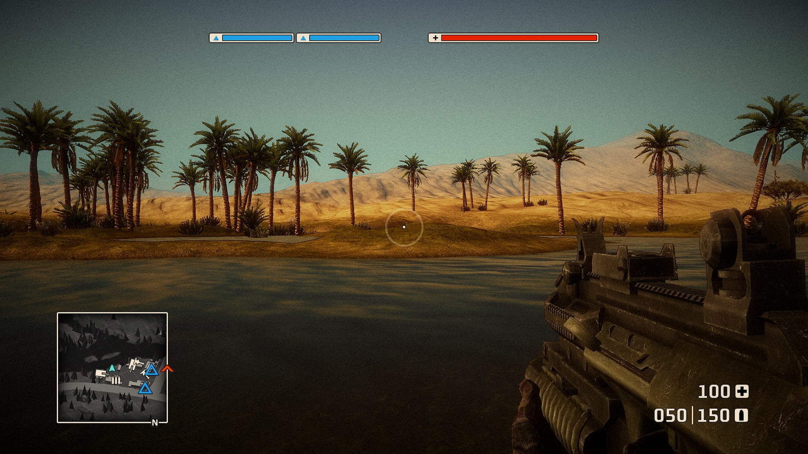 |

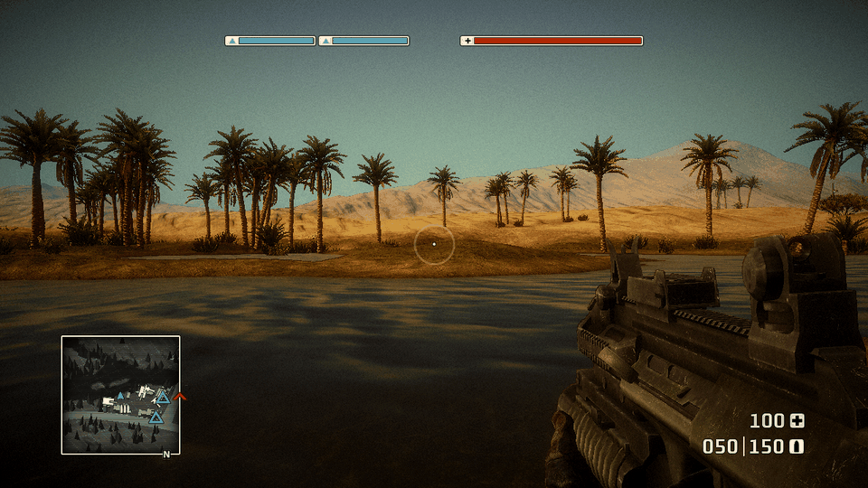

## System Requirements
### Minimum
- **OS**
  - Windows 10 or 11, 64-bit
  - Linux, x86-64 with AVX2
  - macOS 15 (Apple Silicon, through Rosetta) or 14.4 (Intel): experimental, untested
- **GPU** with support for Vulkan (Linux: a Vulkan 1.3 driver; macOS: MoltenVK)
- **For the ray-traced effects:** a GPU with ray tracing, such as NVIDIA RTX or AMD Radeon RX 6000 and newer

> [!NOTE]
> Still being worked on: Bad Company, hosting and joining in the new menus, smarter bots (they still get stuck on some shores and walls), softer edges on ray-traced shadows up close, and an occasional crash at 4K.

## Building
### 1. Clone the Repository
Clone this repository using [Git](https://git-scm.com/).
```
git clone https://github.com/papand7/Battlefield-Recompilation-Project.git
```

### 2. Add the Required Game Files
Place your Battlefield 1943 files in `bf1943-recomp/original/v106/`, with `default.xex` there (and Bad Company's in `bfbc1-recomp/original/`).

### 3. Install Dependencies
- CMake 3.25 or newer, and Ninja
- Visual Studio with the C++ build tools
- LLVM (clang-cl)
- The Vulkan SDK, with `VULKAN_SDK` set

### 4. Build the Project
Recompile the game's code with XenonRecomp and build the game; the commands are in [`bf1943-recomp/README.md`](bf1943-recomp/README.md), and how it all works in [the developer guide](docs/DEVELOPERS.md).

### macOS (experimental, untested)
The code for a Mac build is in the repository, but no one has run it on a Mac yet; expect to fix things, and please report what you find in an issue. It is built from your own game files, like the other builds: an x86-64 program (Apple Silicon runs it through Rosetta), with Vulkan through MoltenVK.

- macOS 15 or newer on Apple Silicon (macOS 14.4 or newer on an Intel Mac)
- `xcode-select --install`, then `brew install cmake ninja python glslang spirv-tools`
- The [LunarG Vulkan SDK](https://vulkan.lunarg.com/sdk/home#mac) (its libraries are universal; Homebrew's Vulkan is arm64 only and will not do)
- `cd bf1943-recomp && ./build_macos.sh --game <folder with default.xex, or the game package>` (Bad Company: add `--bfbc1` and its `.iso`)

The script prints the exact run command when it is done. If it fails, the end of `build/macos-client/logs/build.log` is what to put in the issue. A GitHub Action (`macos-check.yml`) checks that the Mac-specific code compiles.

---

Battlefield is a trademark of Electronic Arts. This is a fan project, not affiliated with EA or DICE.
